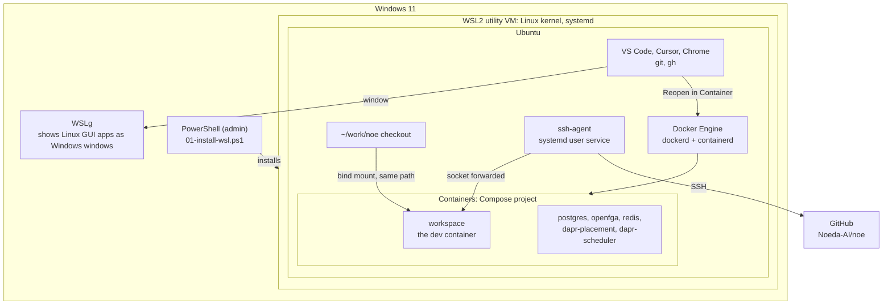

# Architecture

How the Noeda Windows setup fits together. For the steps to follow, see the
[README](../README.md).

## Idea

The developer's machine needs only **PowerShell**. A small Windows script installs WSL2 and
Ubuntu. A second script runs inside Ubuntu and installs everything else, then clones noe.
After that, Windows is just the host: the code, Docker, the editors and the containers all live
in Ubuntu.

Why it is built this way:

- **noe's dev container needs Linux paths.** Its `devcontainer.json` mounts the checkout at the
  same path as on the host. A checkout on `C:\` breaks that, so the checkout lives in Ubuntu
  (`~/work/noe`).
- **No Docker Desktop.** Docker Engine runs in Ubuntu as a systemd service. One engine, one image
  cache, no port clashes, and no licence question.
- **SSH instead of HTTPS credentials.** The dev container forwards an SSH agent and nothing
  else, so Git inside the container only works with an SSH key. The key and agent live in
  Ubuntu, and the script registers the public key on GitHub.

## The stack

## Order of operations

| # | Where | Who | What happens |
|---|---|---|---|
| 1 | Browser | Developer | Downloads the ZIP of this repo from GitHub and extracts it |
| 2 | Windows, admin PowerShell | `01-install-wsl.ps1` | Writes `%UserProfile%\.wslconfig` (mirrored networking), then runs `wsl --install -d Ubuntu`. On a fresh PC this installs WSL only. |
| 3 | Windows | Developer | Reboots |
| 4 | Windows, admin PowerShell | `01-install-wsl.ps1` | Run again: installs Ubuntu and prints the command for step 6 |
| 5 | Ubuntu | Developer | First start: creates a Linux username and password |
| 6 | Ubuntu | `02-setup-ubuntu.sh` | Started from the extracted ZIP via `/mnt/c/...` (see below) |
| 7 | Windows | Developer | Runs `wsl --shutdown` and reopens Ubuntu, only if the script asks |
| 8 | Ubuntu | Developer | `cd ~/work/noe`, then `cursor .` or `code .`, then **Dev Containers: Reopen in Container** |
| 9 | Ubuntu | noe's `initializeCommand` | Builds the image and starts Compose: workspace, postgres, openfga, redis, dapr |

### Inside step 6: `02-setup-ubuntu.sh`

| # | Step | What it does |
|---|---|---|
| 1 | Preflight | Checks it is Ubuntu on WSL2 with systemd, not root, and that Docker Desktop is not providing `docker` |
| 2 | WSL settings | Sets `systemd=true` and `appendWindowsPath=false` in `/etc/wsl.conf` |
| 3 | apt sources | Adds retries and timeouts; switches to a country mirror with `--mirror` |
| 4 | Base packages | Git, curl, build tools, and the libraries a later `pyenv install` needs to build Python |
| 5 | Vendor repos | Adds the Docker, VS Code, Cursor and GitHub CLI apt repositories, then installs Docker Engine, VS Code, Cursor and `gh` |
| 6 | Browser | Installs Chrome (default) or Firefox, or none with `--nobrowser` |
| 7 | Docker Engine | Starts the service and adds the user to the `docker` group |
| 8 | Shell setup | Writes a managed block in `~/.bashrc` (`SSH_AUTH_SOCK`, `BROWSER`, WSL prompt skip) and a browser opener |
| 9 | Git identity | Asks for name and email if not set |
| 10 | SSH | Creates an ed25519 key and starts the systemd `ssh-agent` |
| 10b | SSH server | `openssh-server` on `127.0.0.1:2222`, keys only; authorizes the Windows user's SSH keys and adds host `noe-wsl` to the Windows `~/.ssh/config`, for Windows editors over Remote-SSH (skip with `--no-ssh-server`) |
| 11 | GitHub | `gh auth login` (browser, device code), uploads the SSH public key, checks `ssh git@github.com` |
| 12 | Editors | Installs the Dev Containers extension in VS Code and Cursor |
| 13 | noe checkout | `git clone git@github.com:Noeda-AI/noe.git ~/work/noe` over SSH |

## What each script owns

| | `01-install-wsl.ps1` | `02-setup-ubuntu.sh` |
|---|---|---|
| Runs in | Windows, admin PowerShell | Ubuntu, normal user (uses `sudo`) |
| Needs | PowerShell | Ubuntu with systemd, internet |
| Changes | WSL2, Ubuntu, `%UserProfile%\.wslconfig` | `/etc/wsl.conf`, apt sources, `~/.bashrc` block, `~/.ssh`, `~/work/noe` |
| Safe to rerun | Yes | Yes: every step checks first |

`scripts/win-tools.ps1` is separate. It is an optional utility for installing and removing
Windows-side tools and is not part of the setup path.
